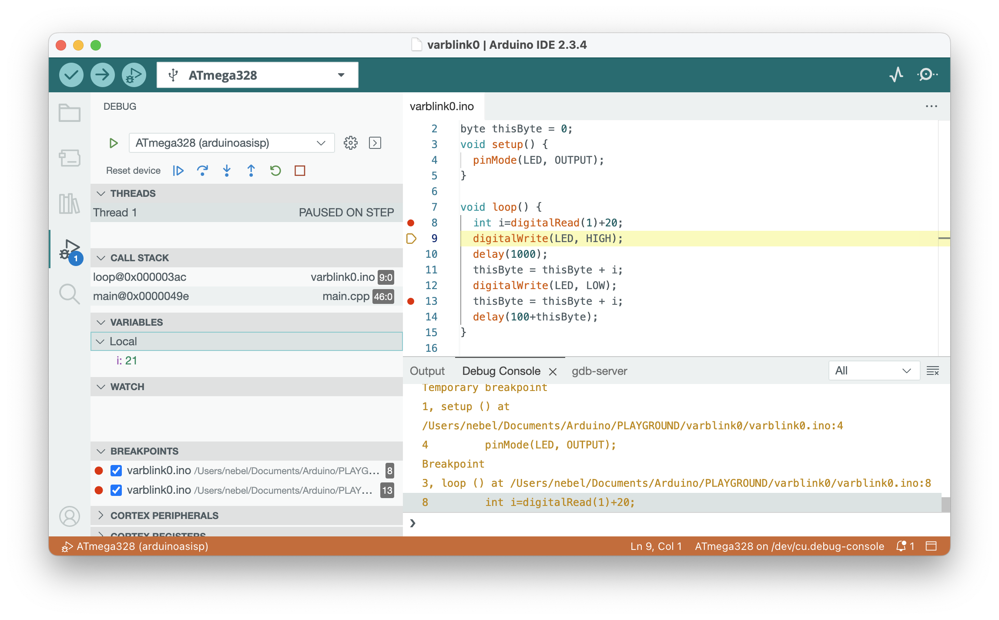

# PyAvrOCD

PyAvrOCD[^1] is *the missing AVR debugging solution* for  [Arduino IDE 2](https://www.arduino.cc/en/software/) and [PlatformIO](https://platformio.org). It is a Python GDB server[^2] for 8-bit AVR MCUs, enabling you to debug programs running on these MCUs using the [GNU Project Debugger GDB](https://www.sourceware.org/gdb/). It communicates with debug probes, such as [MPLAB Snap](https://www.microchip.com/en-us/development-tool/pg164100) or [dw-link](https://felias-fogg.github.io/dw-link), and it provides a pass-through service for the simulation tool [simavr](https://github.com/buserror/simavr).

Why [another open-source GDB server for AVR MCUs](https://arduino-craft-corner.de/index.php/2026/02/10/pyavrocd-1-0-0-released/#what-are-alternatives-to-pyavrocd)? The main intention is to provide a *cross-platform* AVR GDB server, which can be packaged with the Arduino IDE and PlatformIO. In addition to being cross-platform, PyAvrOCD offers some enhancements over its "competitors", particularly in terms of [flash wear](https://arduino-craft-corner.de/index.php/2025/05/05/stop-and-go/) and [single-stepping](https://arduino-craft-corner.de/index.php/2025/03/19/interrupted-and-very-long-single-steps/).

[^1]: How to pronounce PyAvrOCD? Since AVR and OCD are both initialisms, the canonical pronunciations would be Pie-Ay-Vee-Ar-Oh-See-Dee. However, you are free to pronounce it as 'Piaf rocked'.
[^2]: The term *GDB server* is loosely used for programs that provide an interface similar to what the program `gdbserver` does in the context of the GNU Project Debugger GDB. `gdbserver` runs on the target machine, controlling the program to be debugged and communicating with the GDB on the host machine using the *remote serial protocol* (RSP). In contrast to that, a GDB server in the context of embedded debugging usually does not run on the target machine, but either on the hardware debug adapter or on the host. However, it also uses RSP for communicating with GDB.
