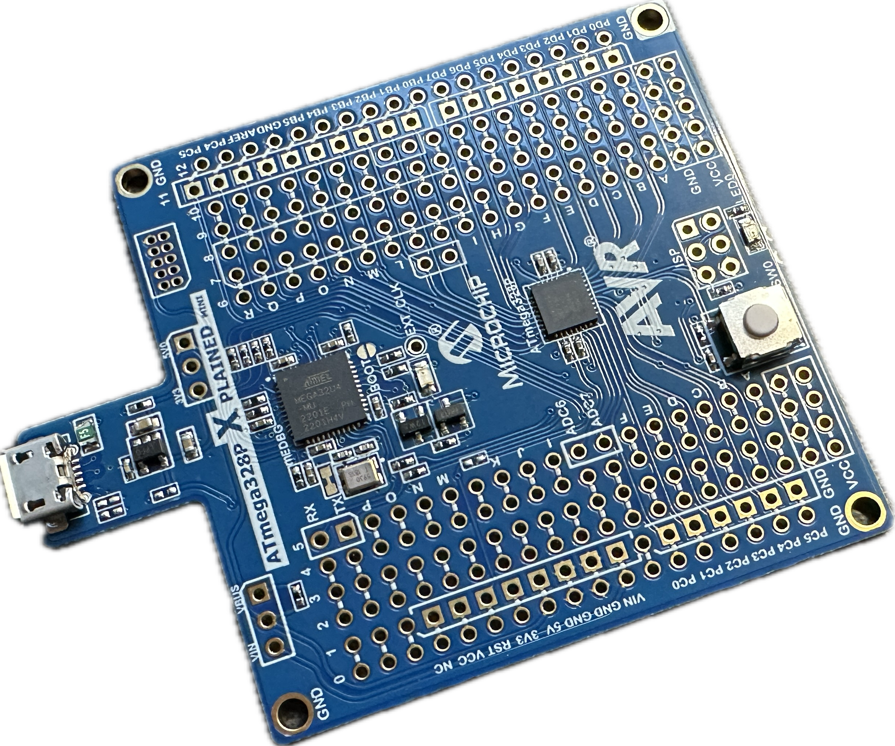

## Quickstart: ATmega328P Xplained Mini

The [Atmega328P Xplained Mini](https://www.microchip.com/en-us/development-tool/atmega328p-xmini) development board, which has an Arduino Uno footprint, is ideal for making a first experience with embedded debugging because it already contains an onboard debugger. It is simply plug-and-play.

### Required hardware

The only thing you need is the XPlained Mini board and a USB cable to connect it to your computer.

<p align="center">

</p>


### Step 1: Install the debug-capable XMiniCore

Add new *boards manager URLs* in the `Preferences` dialog:

```
https://felias-fogg.github.io/XMiniCore/package_felias-fogg_XMiniCore_index.json
https://felias-fogg.github.io/AvrDebugger/package_felias-fogg_AvrDebugger_index.json
```

{!details-boards-manager-url.md!}

Next you have to install the new packages. Activate the `Boards Manager`, select `XMiniCore`, and click on `Install`. Then the same with `AvrDebugger`.

{!details-install-package.md!}

!!! info "Linux systems"
    After the installation, users of Linux systems will need to add `udev` rules. Download [https://pyavrocd.io/99-edbg-debuggers.rules](https://pyavrocd.io/99-edbg-debuggers.rules), edit if you want, and copy to `/etc/udev/rules.d/`.

### Step 2: Load sketch and select board

Load a sketch, e.g., the `Blink` sketch, and select the right board: `Tools -> Board -> XMiniCore -> Atmel atmega328p Xplained mini`. If you want to use serial I/O, you may also want to select the right `Port` in the `Tools` menu.

### Step 3: Compile and upload the sketch

Activate `Optimize for Debugging` in the `Sketch` menu. This only needs to be done once. Then click on the `Upload` button (arrow to the right) in the top bar. This will compile and upload the sketch.

### Step 4: Debug the sketch

It is time to start debugging by clicking the `Debug` button (bug in front of a triangle) in the top row. This will open the `DEBUG` pane after a while. Now you can start and stop execution, inspect variables, set breakpoints, and the like (see section on [debugging](debugging.md)). Clicking on the red square in the top bar of the DEBUG pane will terminate the current debugging episode.

### Step 5: Start over or terminate the debugging session

You can now edit the sketch and start again at step 3. Note that you always have to recompile and restart the debugger before any changes you made to the sketch are effective.

If you want to stop debugging, it may be a good idea to deactivate the `Optimize for Debugging` option again.

### Potential problems

If something goes wrong, it is a good idea to have a look at the output of the `gdb-server` console. Messages with the prefix \[CRITICAL] often tell what went wrong. It may also be a good idea to consult the [Troubleshooting](troubleshooting.md) and the [Limitations](limitations.md) section of the PyAvrOCD manual.

!!! danger "Warning:  Use IOREF to source attached circuits"
    If you have any attached circuitry, be it on a breadboard or a shield, use the `IOREF` pin to power it. If this is not possible, check out the [`README` file of XminiCore for a solution](https://github.com/felias-fogg/XMiniCore?tab=readme-ov-file#powering-external-circuitry).
